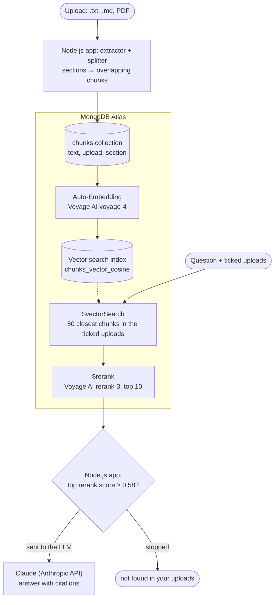

# RAG Knowledge Base on MongoDB Atlas

Upload text files, Markdown and text-based PDFs, then ask questions in plain
language. The app answers only from your uploads, and every answer cites the upload
and section it came from. If the uploads don't hold the answer, it says
"not found in your uploads" instead of guessing.

A solo portfolio project that shows what MongoDB Atlas can do for retrieval:
Vector Search with Auto-Embedding and reranking with `$rerank` for the answers, and
Atlas Search autocomplete and facets for the upload picker. Answers are written by
Claude (Anthropic API) with built-in citations.


## What it showcases

- **Atlas Vector Search with Auto-Embedding.** The app stores only chunk text. Atlas
  embeds it with Voyage AI (`voyage-4`) through the vector search index
  `chunks_vector_cosine`, and embeds each question the same way, so the app never
  creates or handles a vector.
- **Pre-filtered search.** The user ticks one or more uploads, or "All uploads", and
  the search is filtered on their ids. Ticked uploads use exact search; "All uploads"
  uses approximate search.
- **Reranking with `$rerank`.** Vector search fetches 50 candidates; the aggregation
  stage `$rerank` (Voyage AI `rerank-3`, run by Atlas) re-sorts them by how well each
  answers the question, and the top 10 go to the LLM. On for every answer.
- **A "not found" threshold on the rerank score.** Below it, the app answers "not
  found" without calling the LLM.
- **Atlas Search autocomplete.** Typo-tolerant title search in the page's upload
  picker, on the Atlas Search index `uploads_title_autocomplete`.
- **Atlas Search facets.** The picker's Filter block counts uploads by file type and
  by size with `$searchMeta` (a string facet and a number facet, on the same index
  `uploads_title_autocomplete`), and its chips filter the list and the title search.

## How it works



1. **Ingest.** An extractor per file type splits the upload into sections (Markdown
   headings, PDF pages, or the whole plain-text file), and a splitter cuts each
   section into overlapping chunks. Each chunk is saved as one MongoDB document with
   its text, upload id, file name and section.
2. **Embed.** Atlas embeds each new chunk in the background, through the vector
   search index. A new upload becomes searchable a few seconds later; the page shows
   "processing… → ready".
3. **Search.** The question goes to Atlas as text. `$vectorSearch` finds the 50
   closest chunks within the ticked uploads, and `$rerank` re-sorts them.
4. **Answer.** If the best rerank score is below the threshold, the question is
   stopped: the app replies "not found in your uploads" and the LLM isn't called.
   Otherwise the top 10 chunks are sent to the LLM as search results, and Claude
   answers with citations that map back to an upload and section. A reply with no
   citations also counts as "not found".

[ARCHITECTURE.md](docs/ARCHITECTURE.md) maps every file and command, and
[API_SPEC.md](docs/API_SPEC.md) describes the API's routes and the web page's behaviour.

## The queries, in code

Simplified from the app's code, in Node.js driver syntax.

### Answers: vector search and reranking

From [src/search.js](src/search.js), which also numbers each chunk's rank before and
after reranking, counts the candidates and joins each chunk's upload.

**The vector search index `chunks_vector_cosine`** (on the `chunks` collection; from
[src/indexes.js](src/indexes.js)). The `autoEmbed` field tells Atlas to embed `text`
itself; `uploadId` is a filter field, so searches can be limited to some uploads.

```js
await db.collection('chunks').createSearchIndex({
  name: 'chunks_vector_cosine',
  type: 'vectorSearch',
  definition: {
    fields: [
      {
        type: 'autoEmbed',
        modality: 'text',
        path: 'text',            // the field Atlas embeds
        model: 'voyage-4',
        numDimensions: 1024,
        quantization: 'scalar',
        similarity: 'cosine',
      },
      { type: 'filter', path: 'uploadId' },
    ],
  },
});
```

**Vector search, then rerank.** Both stages take the question as text: Atlas embeds
it for `$vectorSearch`, and the reranker reads it next to each candidate's text.
`uploadIds` holds the `_id` values of the ticked uploads, as ObjectIds. For "All
uploads", the app passes the ids of every searchable upload and uses approximate
search instead of `exact`.

```js
const { ObjectId } = require('mongodb');

const question = 'How do I set up a proxy for Nimbus?';
const uploadIds = [new ObjectId('…')];   // the ticked uploads' _id values

const results = await db.collection('chunks').aggregate([
  {
    $vectorSearch: {
      index: 'chunks_vector_cosine',
      path: 'text',
      query: { text: question },                  // embedded by Atlas, no vector needed
      filter: { uploadId: { $in: uploadIds } },   // ObjectIds; strings match nothing
      exact: true,                                // a few uploads: check every chunk
      // numCandidates: 1000,                     // approximate search instead (All uploads)
      limit: 50,                                  // the candidates for reranking
    },
  },
  {
    $project: {
      fileName: 1, section: 1, text: 1,
      vectorScore: { $meta: 'vectorSearchScore' },   // cosine similarity
    },
  },
  {
    $rerank: {
      query: { text: question },
      path: 'text',             // what the reranker reads
      numDocsToRerank: 50,
      model: 'rerank-3',
    },
  },
  { $set: { score: { $meta: 'score' } } },     // the rerank score replaces the search score
  { $sort: { score: -1, vectorScore: -1 } },   // the cosine score breaks ties
  { $limit: 10 },                              // what goes to the LLM
]).toArray();
```

**The threshold check** (from [src/answer.js](src/answer.js)). Rerank scores separate
answers from unrelated chunks far better than cosine scores do, so one number stops
most unanswerable questions before the LLM is called.

```js
if (!results.length || results[0].score < 0.58) {
  return 'not found in your uploads';   // stopped: no LLM call
}
```

### The upload picker: Atlas Search autocomplete and facets

From [src/title-search.js](src/title-search.js). One Atlas Search index,
`uploads_title_autocomplete`, serves both the title search and the Filter block's
counts.

**The Atlas Search index `uploads_title_autocomplete`** (on the `uploads` collection;
from [src/indexes.js](src/indexes.js)). `autocomplete`
fields index the start of each word (edge n-grams of 2 to 20 letters), so a few typed
letters find a title. A custom analyzer splits file names into words at hyphens,
underscores and dots, which the standard one doesn't. `fileType` and `chunkCount` are
there for the facets and the chip filters.

```js
const AUTOCOMPLETE = {
  type: 'autocomplete',
  tokenization: 'edgeGram',   // index word starts: "ni", "nim", "nimb", …
  minGrams: 2,
  maxGrams: 20,
  foldDiacritics: true,       // "cafe" finds "Café"
};

await db.collection('uploads').createSearchIndex({
  name: 'uploads_title_autocomplete',
  type: 'search',
  definition: {
    analyzers: [
      {
        name: 'fileNameWords',
        tokenizer: { type: 'regexSplit', pattern: '[-_.\\s]+' },   // "nimbus-guide.md" → nimbus, guide, md
        tokenFilters: [{ type: 'lowercase' }],
      },
    ],
    mappings: {
      dynamic: false,   // index only the fields below
      fields: {
        title: AUTOCOMPLETE,
        fileName: { ...AUTOCOMPLETE, analyzer: 'fileNameWords' },
        status: { type: 'token' },        // to search complete uploads only
        fileType: { type: 'token' },      // facet and filter: pdf, md, txt
        chunkCount: { type: 'number' },   // facet and filter: the size
      },
    },
  },
});
```

**Title search.** Every typed word must start a word of the title or the file name, so
"nim gui" finds "Nimbus CLI Guide". Words of 4 letters or more may have one typo.
Filter clauses (complete uploads, the ticked chips) narrow the results without
changing their score.

```js
const words = ['nim', 'gui'];   // what was typed, split into words

const results = await db.collection('uploads').aggregate([
  {
    $search: {
      index: 'uploads_title_autocomplete',
      compound: {
        must: words.map((word) => ({
          compound: {
            should: ['title', 'fileName'].map((path) => ({
              autocomplete: {
                path,
                query: word,
                // one typo from 4 letters on; the first letter must be right
                ...(word.length >= 4 && { fuzzy: { maxEdits: 1, prefixLength: 1 } }),
              },
            })),
            minimumShouldMatch: 1,   // the title or the file name
          },
        })),
        filter: [
          { equals: { path: 'status', value: 'complete' } },
          { in: { path: 'fileType', value: ['md'] } },   // the ticked Type chips
        ],
      },
    },
  },
  { $limit: 8 },
]).toArray();
```

**Facets.** `$searchMeta` returns counts instead of uploads. A string facet counts
uploads per file type; a number facet counts them in chunk-count ranges, each bucket
starting at a boundary, with `default` for the rest.

```js
const [{ facet }] = await db.collection('uploads').aggregate([
  {
    $searchMeta: {
      index: 'uploads_title_autocomplete',
      facet: {
        operator: { equals: { path: 'status', value: 'complete' } },   // which uploads to count
        facets: {
          type: { type: 'string', path: 'fileType', numBuckets: 3 },
          size: {
            type: 'number',
            path: 'chunkCount',
            boundaries: [1, 10, 100],   // small: 1–9 chunks, medium: 10–99
            default: 'large',           // 100 or more
          },
        },
      },
    },
  },
]).toArray();
// facet.type.buckets: [{ _id: 'txt', count: 3 }, { _id: 'md', count: 2 }, { _id: 'pdf', count: 2 }]
// facet.size.buckets: [{ _id: 1, count: 3 }, { _id: 10, count: 3 }, { _id: 'large', count: 1 }]
```

With chips ticked, the app runs one `$searchMeta` per row, each filtered by the other
row's chips, so each count says what ticking that chip would add.

## Results

Measured with 71 test questions ([test/questions.json](test/questions.json)) against
7 uploads (360 chunks), each searched in All uploads, in its own upload and in a
wrong one:

- **Reranking puts the answer first more often:** for 40 of 43 questions, against 33
  with vector search alone (All uploads).
- **Rerank scores make the threshold useful.** At 0.58, every answerable question is
  sent to the LLM, and every wrong-upload and off-topic search is stopped. With cosine
  scores, most of those had to be sent to the LLM, which replied "not found" itself:
  in a full test run, questions with no answer in the searched uploads reached the LLM
  55 times with vector search alone and 4 times reranked.

Each test question's best score in one upload, before and after reranking. The two
panels use different scores (cosine, then rerank), so compare each dot with its own
panel's threshold:


How many test questions come out right on each check:


The full comparison: [test/RERANKING.md](test/RERANKING.md). Decisions, measurements
and the reasons behind each setting: [PROJECT_PLAN.md](docs/PROJECT_PLAN.md).

## Quick start

**You need:**

- Node.js 22 LTS or later.
- For `$rerank` with the `rerank-3` model ([requirements](https://www.mongodb.com/docs/vector-search/query/aggregation-stages/rerank/)):
  a **dedicated Atlas cluster (M10 or larger, a paid tier) running MongoDB 9.0 or
  later**, with **Native Reranking enabled** in the project's settings. On the free
  M0 (MongoDB 8.0), ingesting and searching work, but answers fail unless asked
  without reranking (`npm run ask -- "…" --no-rerank`), and the web page always
  reranks. Auto-Embedding and reranking need no Voyage AI account: Atlas runs both.
- Your IP address in Atlas **Network Access**.
- An Anthropic API key.

**Steps:**

1. Install the dependencies:

   ```bash
   npm install
   ```

2. Copy `.env.example` to `.env` and fill in `MONGODB_URI` and `ANTHROPIC_API_KEY`.
3. Create the collections and indexes. The search indexes build in the background;
   `npm run index-status` shows when they're ready.

   ```bash
   npm run setup
   ```

4. Upload the samples (small files on unrelated topics, so searches have
   distractors), or your own files from the web page:

   ```bash
   npm run ingest -- samples/nimbus-guide.md
   ```

5. Start the server and open `http://127.0.0.1:3000`:

   ```bash
   npm start
   ```

Or ask from the command line:

```bash
npm run ask -- "How do I set up a proxy for Nimbus?"
```

Each question with an answer is one LLM call, about $0.01–0.015 with Claude Sonnet
5.5, the default. A question stopped by the threshold costs nothing. To answer with
another Claude model, set `ANSWER_MODEL` in `.env` to its model ID (see
`.env.example`); only the default has been tested.

The test questions also cover two PDFs that aren't in the repository (they're
copyrighted), so `npm run test-questions` gives different results on a fresh clone.

## Troubleshooting

**"SSL alert number 80" (`tlsv1 alert internal error`) when connecting.** Your IP
address has changed: add the new one in Atlas Network Access. The driver may label
this `SystemOverloadedError`, but it isn't an Atlas outage.

**Every question fails, on the page and with `npm run ask`, but
`npm run ask -- "…" --no-rerank` works.** The cluster can't run `$rerank`. It needs
all three: MongoDB 9.0 or later, a dedicated cluster (M10 or larger; the free M0 runs
8.0), and Native Reranking enabled in the project's settings. Fix whichever is
missing, or ask from the command line with `--no-rerank`.

**LLM requests go to the wrong address, though `.env` looks right.** A variable
already set in your shell wins over `.env`. Some tools set `ANTHROPIC_BASE_URL`
themselves (the Claude desktop app's shell sets it to `https://api.anthropic.com`).
Check with:

```bash
node -e "console.log(process.env.ANTHROPIC_BASE_URL)"
```

**The page says the LLM "didn't accept this server's key", through a company
gateway.** A gateway set in `ANTHROPIC_BASE_URL` may answer `403` (for example
`RBAC: access denied`) when the app runs outside its network. Connect to the company
network or VPN, or use the Anthropic API directly (leave `ANTHROPIC_BASE_URL` unset).

## License

[MIT](LICENSE)
